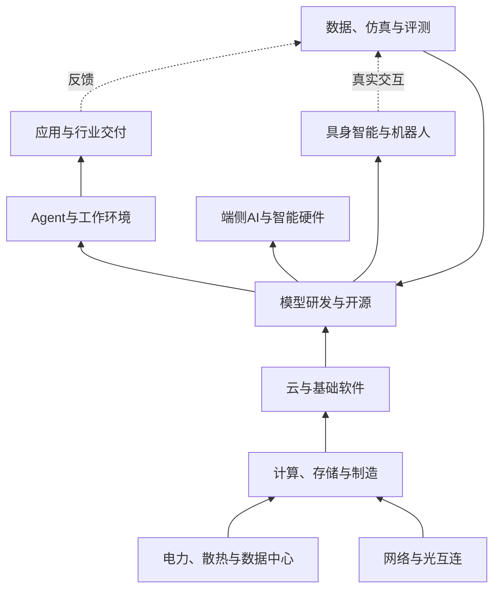

# AI 产业链研究地图

从一项 AI 任务出发，理解计算、存储、互连、电力、模型、软件与应用如何协作，以及价值和风险怎样沿产业链传递。

这是一份持续积累的中文学习知识库。保留产业梳理、学习笔记、讲稿、图示和演讲附件；个人身份、联系方式、账户及内部工作区链接经过脱敏处理。

## 从哪里开始

- 先看下面的十个板块，按想弄清的问题进入。
- 找某篇旧笔记，使用[完整资料索引](notes/README.md)。
- 不确定先读哪部分，可看[阅读指引](docs/reading-guide.md)。
- 想继续补资料，参考[维护方式](CONTRIBUTING.md)和[笔记模板](templates/note.md)。

## 产业链地图



图中是依赖与反馈关系的简化表达。技术、客户需求与资本约束会相互影响，不能把它理解为单向流水线。

## 十个研究板块

| 板块 | 入口 |
| --- | --- |
| 计算、存储与制造 | [芯片如何形成可用算力](topics/01-compute-memory-manufacturing/README.md) |
| 光通信与光互连 | [技术路线、公司分工与关键判断](topics/02-optical-interconnect/README.md) |
| 电力、数据中心与云 | [算力如何建成并交付](topics/03-power-datacenter-cloud/README.md) |
| 模型研发与开源 | [能力如何形成并扩散](topics/04-models-open-source/README.md) |
| 数据、仿真与评测 | [训练反馈从哪里来](topics/05-data-simulation-evaluation/README.md) |
| Agent与基础软件 | [把模型组织成能办事的系统](topics/06-agents-software/README.md) |
| 应用与行业交付 | [能力怎样变成付费需求](topics/07-applications-delivery/README.md) |
| 端侧AI与智能硬件 | [设备、边缘和云怎样分工](topics/08-edge-ai-hardware/README.md) |
| 具身智能与机器人 | [从零部件到整段工作流](topics/09-embodied-robotics/README.md) |
| 产业竞争、资本与治理 | [价值由谁留下](topics/10-capital-competition-governance/README.md) |

## 内容与边界

- 当前版本：2026-11-26，10 个专题入口、91 份既有笔记及 1 份光通信原始素材记录。
- **事实、来源主张、讨论推论、待核验信息分别理解。** 旧笔记标注过“已核对”，只代表当次记录，不能替代本次最新核验。
- 技术路线、公司战略和投资回报是不同问题。行业增长不自动等于每家供应商的利润增长。
- 本项目保留历史材料中的标题与讨论，不把它们全部提升为项目当前认可的事实。引用有争议的事件、数字或预测前，应回查一手来源。
- 第三方讲稿、论文、报告和演讲附件的权利归原作者；见[资料使用说明](RIGHTS.md)。
- 全文与附件的保存范围、脱敏处理见[公开版本说明](docs/publication-notes.md)。

## 文件结构

```text
topics/       按产业环节组织的专题、笔记入口与知识缺口
notes/        学习笔记、研究讨论与原有证据边界
assets/       讲稿、图片与经过隐私检查的演讲附件
docs/         阅读方法、公开范围及维护说明
templates/    新增笔记模板
catalog.json  标题和本地文件路径索引
```

## 更新记录

见 [CHANGELOG.md](CHANGELOG.md)。本版本为一次整理快照；没有配置 Notion 与 GitHub 的自动双向同步。
