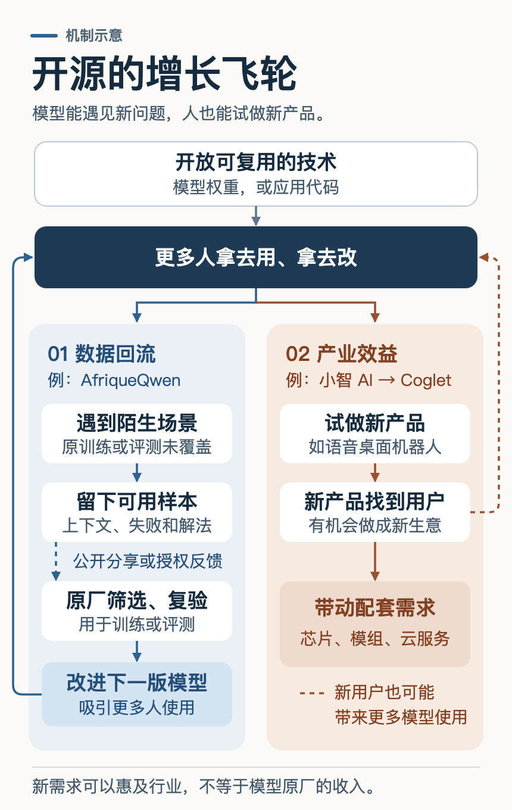

# AI 开源的增长飞轮：数据回流与新增需求

> 学习归档：保留来源陈述、讨论与原有核验边界；不是对所有事件和数据的重新确认。涉及公司、价格、政策和产品状态，请按原记录日期阅读并回查来源。

讨论笔记 · 2026-11-21

**开放技术的回报，不只是让原有业务做得更便宜。它还让外部的人有条件去试原厂顾不上的问题，以及原本未必会做的产品。** 前者可能变成下一版模型的研发材料，后者可能变成新的交易。两笔回报都不是自动到账。

## 飞轮图：更多人拿去用、拿去改

*机制示意。蓝线是数据回流，赭线是新增需求；虚线表示有条件的反馈或新增使用，不代表两个案例已经跑完闭环。*

- **数据这一圈：** 模型到了新场景，暴露出原有训练或评测没有覆盖的问题。外部团队公开实验，或用户授权分享反馈；原厂核对来源与许可、复验并筛选，合适的材料才进入训练或评测。下一版若能解决更多问题，就有机会进入更多场景。
- **需求这一圈：** 开发者复用现成代码或模型做出样机，用真实用户验证有没有人需要、愿不愿意付钱。新产品若找到用户，也可能带来新的模型使用和配套服务需求。受益的是整个生态，不一定是原厂。

## AfriqueQwen：外面试出来的问题，怎么变成研发材料

研究团队拿公开的千问基础模型接着训练，针对 20 种非洲语言做适配，并公开了改过的模型、训练方法和评测结果。开放权重让他们不用从零训练，也不用等原厂为这个问题排期。**开放权重不等于公开原始训练数据。**

可以拿豪萨语举个假设：模型把一句惯用语按字面理解了。「它答得不好」只是线索；如果能留下原句、语境和当地人认可的理解，工程师就多了一道能复做的考题。论文提供的训练对照更进一步：团队在 Gemma 3 的一个版本上发现，只补单语文本，翻译成绩上升，数学成绩却略降；使用混有数学和代码的数据配方后，部分推理成绩回升。这些取舍本身，也值得后来者复验。

**证据边界：** AfriqueQwen 证明外部团队可以提出问题、做实验并公开成果。没有公开证据显示千问已把这些成果纳入下一版；私有部署的对话也不会因为权重开放就自动回传。

[AfriqueLLM 论文](https://aclanthology.org/2026.acl-long.267/) · [AfriqueQwen 模型说明](https://huggingface.co/McGill-NLP/AfriqueQwen-4B)

## 小智 AI：有些买卖，原来连试的机会都没有

英国创客 Will Cogley 做了桌面机器人 Coglet，默认的 ESP32 语音方案基于小智 AI。小智 AI 开放的是把语音识别、大模型、语音合成接起来的工程代码，和千问开放模型权重是两件事。创作者可以复用语音部分，把功夫花在机器人的外形、动作和表情上。Coglet 众筹超过 10 万英镑，至少说明有人愿意为这个点子付钱。

**区分省钱与创造需求：** 一款原本就会上市的音箱用现成代码，是省开发费；一个创作者原先只做得起外形和动作，现在能让样机开口并拿去试卖，这才可能多出一笔原本不会发生的交易。

**证据边界：** 众筹不是销量、交付或利润。也不能断定没有小智 AI 就一定没有 Coglet，更不能把行业新增需求直接算成模型原厂的收入。

[小智 AI 仓库](https://github.com/78/xiaozhi-esp32) · [Coglet 官方说明](https://nmrobots.com/pages/coglet) · [Coglet 众筹页](https://www.kickstarter.com/projects/willcogley/coglet-open-source-3d-printable-robot-companion-kit)

## 以后看开放项目，可以问三句

1. 它替外部团队省掉了哪一步？没省掉这一步，对方还会做吗？
2. 新问题从哪里被发现，有没有合法、可复验的路径回到原厂？
3. 多出来的需求落在谁手里，原厂有没有用户愿意付费的部署、托管或其他服务去接？

本笔记来自《AI 公司为什么舍得把模型开源？》的写作讨论，保留观点推演，和公众号草稿分开。
