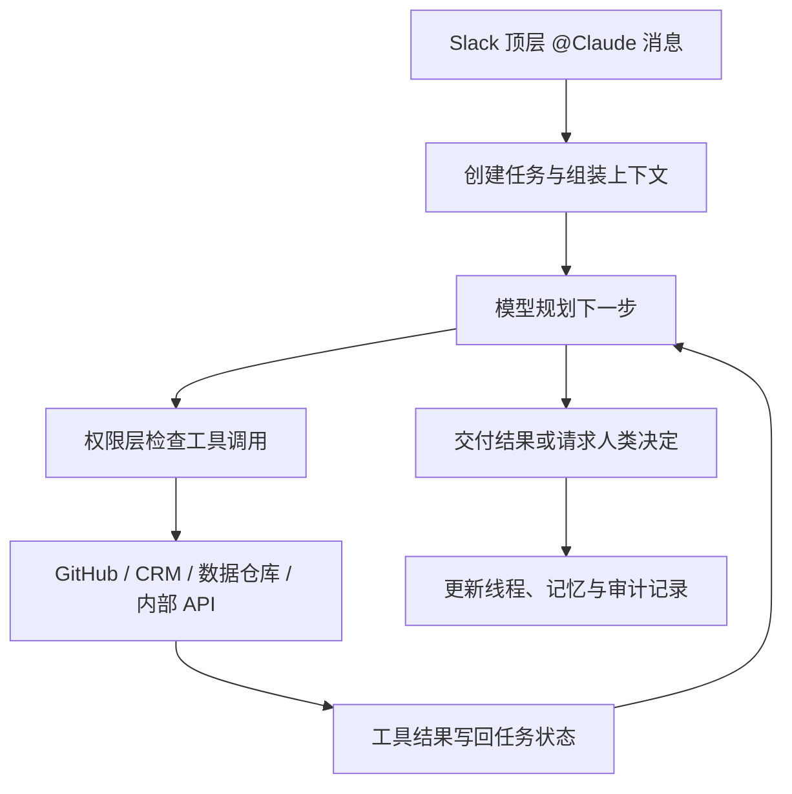

# Claude Tag：从私人助手到组织级共享 Agent

> 学习归档：保留来源陈述、讨论与原有核验边界；不是对所有事件和数据的重新确认。涉及公司、价格、政策和产品状态，请按原记录日期阅读并回查来源。

# 核心问题

Claude Tag 是否只是“Claude 的 Slack 插件”？它如何运行、如何部署、数据经过哪里，以及当 AI 以独立身份进入团队后，组织的权限和协作方式会怎样变化？

> **当前判断**：Claude Tag 是 Anthropic 托管的组织级 Agent 运行平台。Slack 是入口；真正的产品价值来自共享上下文、持久任务、频道记忆、独立 Agent Identity、工具执行与审计。

# 一、产品边界

## 它与普通 Claude 对话的区别

- 普通 Claude 更像个人临时顾问：上下文属于个人会话，任务结束后由用户接手。
- Claude Tag 更像团队共享的数字同事：任何频道成员都能 `@Claude`，查看进度、补充方向并接手任务。
- 它能在用户离线后继续工作，等待 CI、定时器或外部事件，再恢复任务。
- 频道任务使用组织配置的 Agent 身份和工具；DM 使用个人 Claude 账号及个人连接器。

## 它与传统 Slack Bot 的区别

传统 Bot 常是“命令 → 固定程序 → 返回结果”。Claude Tag 接收目标后，会拆解任务、调用多种工具、保存状态、等待事件并在后续继续判断。

> 关键变化：AI 的工作单元从一段私人对话，变成一项由团队共同观察、接力和验收的任务。

# 二、一次任务如何运行

## 任务边界

- 每条顶层消息启动一个新任务。
- 同一线程的回复用于补充、纠正和重新定向。
- 线程是任务边界，但不是完整的记忆边界；同一频道的任务会共享频道记忆。

## 上下文层次

一次模型调用可能由以下内容组装：

- 当前 Slack 线程；
- 与任务相关的频道历史；
- 频道长期记忆；
- workspace 公共记忆；
- 管理员配置的 standing instructions；
- 当前任务状态和可用工具说明。

Anthropic 没有公开具体检索、压缩和向量存储实现，因此这里应区分公开能力与架构推断。

## 长任务并非模型连续运行

模型不会在等待 40 分钟 CI 时持续“思考”。更合理的机制是：保存状态 → 暂停 → CI 完成或定时器触发 → 再次调用模型。长任务依赖的是**持久化任务状态、事件触发和多次模型调用**。

# 三、Agent Identity 与工具执行

Claude 在共享频道里不借用某个员工的账号，而使用管理员配置的独立身份：

- 在 Slack 中以 Claude App 发言；
- 在 GitHub 中以 Claude GitHub App 创建 PR；
- 通过服务账号查询数据仓库；
- 凭证与频道身份绑定，并在网络执行边界注入；
- 未获允许的出站主机被阻断；
- 网络调用同时进入 Claude Tag 和目标系统的日志。

> 模型不需要看到 API key 明文，但工具返回的数据通常仍需交给模型处理。**凭证不进入提示词，不等于业务数据不经过 Anthropic。**

## 权限层级

| 层级 | 作用 | 风险提示 |
| --- | --- | --- |
| 组织级 | 所有 Claude Tag 安装位置继承的连接与仓库 | 避免放置高权限凭证 |
| Workspace | 公共频道共享的权限与公共记忆 | 公共频道成员可能借 Claude 间接访问资源 |
| 私有频道 | 额外凭证、仓库和独立记忆边界 | 按最小权限配置 |

# 四、隐私与数据

## 可以做到的事

- 商业客户数据默认不用于训练 Anthropic 的通用模型；自愿数据共享计划另算。
- 原始数据库、代码库和 CRM 可以继续保存在企业基础设施。
- 管理员可以限制 Claude 访问的频道、仓库、API、主机和预算。
- 管理员可以查看、编辑和删除 Claude Tag 记忆，并审计任务与网络调用。

## 做不到的事

- 原生 Claude Tag 当前没有公开的本地部署包或模型权重。
- 使用官方服务时，完成任务所需的 Slack 上下文和工具结果仍需进入 Anthropic 托管的推理与 Agent 链路。
- “不用于训练”不能解释成“Anthropic 从未处理数据”。

## 三类泄露

1. **越权读取**：频道 Agent 权限高于发起人的个人权限，Claude 可能成为权限侧门。
2. **内容泄露**：直接把私有频道原文或数据带到公共空间。
3. **影响泄露**：不复述秘密，但秘密改变了公共排序、建议或行动。

影响泄露可用反事实测试判断：若删除私密输入，公共输出是否会明显变化？如果会，说明秘密已经跨域影响答案。

# 五、部署方式

Claude Tag 是 SaaS 接入，不需要企业运行服务器或容器。

## 前提

- Claude Team 或 Enterprise；
- Slack workspace；
- Claude Primary Owner 或 Owner；
- Slack 应用安装权限；
- GitHub App、数据仓库服务账号或企业 API 网关等工具权限。

## 推荐上线顺序

1. 在 Claude 组织后台配对 Slack workspace。
2. Provision Claude Agent Identity。
3. 创建 3–5 人的私有试点频道。
4. 初期只允许被 `@Claude` 时响应，不开主动监控和定时任务。
5. 先连接只读知识库和测试仓库，再逐项增加权限。
6. 内部数据优先通过企业网关输出脱敏、限量结果，不直接开放原始数据库。
7. 设置组织和频道费用上限，观察 75% 与 95% 告警。
8. 完成功能、越权、Prompt injection 与长任务恢复测试后再扩大范围。

## 最小可行试点

`Claude Team/Enterprise + Slack 私有频道 + 3–5 名成员 + 一个只读知识库 + 一个测试 GitHub 仓库 + 每频道预算上限`

# 六、组织与社会效应

## 正面价值

- 减少重复交代背景和跨系统搬运信息；
- 多人可以围绕同一 Agent 任务接力；
- 将数据查询、工单、代码和文档串成可执行工作流；
- AI 行为拥有独立身份和日志，责任归属比共享员工账号更清楚。

## 结构性风险

- 频道从聊天空间变成权限与长期记忆边界；
- 审计功能也可能成为员工监控基础设施；
- 员工知道管理者可查看任务和记忆后，可能把真实讨论移出公共频道；
- 多人同时控制 Agent 时会出现优先级和责任冲突；
- 接入越多工具，价值与攻击面同时增长。

# 七、我的理解

1. Claude Tag 的护城河不是 Slack Bot，而是 Agent Identity、持久任务、共享记忆、工具执行和审计的组合。
2. “多人 AI”不是把私聊窗口放进群聊，而是把任务状态、权限和责任从个人迁移到组织空间。
3. 部署判断不能只看模型效果，应同时测：背景交代时间、可直接采用的交付比例、人工审核成本、越权率和单任务费用。
4. 高敏感企业需要在 Claude Tag 与内部系统之间增加数据网关：身份校验、字段脱敏、结果限量、用途控制与审计。
5. 原生 Claude Tag 适合接受 Anthropic 托管处理、但要求商业数据不训练且可审计的组织；要求推理完全不出内网的企业，应选择自有云 Agent 或本地模型方案。

# 八、理解检验

- 为什么跨天任务依赖的不是“无限上下文”，而是状态机与事件触发？
- Agent Identity 为什么比借用发起人凭证更适合多人协作？
- 频道权限为何可能成为员工个人权限的侧门？
- “数据不用于训练”与“数据不经过 Anthropic”有什么区别？
- 内容泄露和影响泄露如何用反事实测试区分？

# 九、待继续追踪

- Claude Tag 是否会支持 AWS、Google Cloud、Microsoft Foundry 或客户自有云部署。
- 请求者个人权限与频道 Agent 权限的交集控制何时上线。
- Just-in-time credential grant 与高风险操作审批的实际形态。
- 频道记忆的检索、压缩、污染修复和跨域隔离机制。
- 独立第三方对 Prompt injection、非干扰性和数据边界的安全评测。

# 来源

- [Introducing Claude Tag](https://www.anthropic.com/news/introducing-claude-tag)
- [What is Claude Tag?](https://support.claude.com/en/articles/15594475-what-is-claude-tag)
- [Agent identity in Claude Tag](https://claude.com/blog/agent-identity-access-model)
- [Best practices for using @Claude](https://claude.com/resources/tutorials/best-practices-using-claude-tag)
- [Anthropic Development Partner Program](https://support.claude.com/en/articles/11174108-about-the-development-partner-program)

> 信息截至 2026-08-12。Claude Tag 仍处于 beta，产品能力、菜单与数据政策可能变化。
