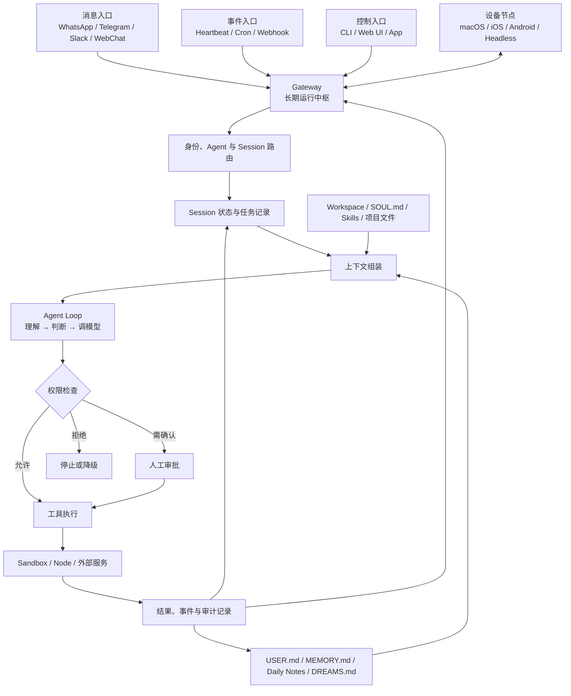

# OpenClaw：长期 Agent 架构、记忆权限与安全边界

> 学习归档：保留来源陈述、讨论与原有核验边界；不是对所有事件和数据的重新确认。涉及公司、价格、政策和产品状态，请按原记录日期阅读并回查来源。

# 核心问题

OpenClaw 如何通过 Gateway、Session、记忆、权限与工具组成一个长期运行的 Agent？它有哪些真实安全风险？创始人 Peter Steinberger 加入 OpenAI 后，项目的技术和治理边界发生了什么变化？

> **当前判断**：OpenClaw 是目前最有启发性的个人 Agent 架构之一。它的价值来自持续调度、身份连续性、可控行动和可修正记忆；它的主要风险也来自同一组合。现阶段更像 Linux 早期服务器，而不是可以无脑托管核心数字身份的消费产品。

# 一、OpenClaw 的定位

OpenClaw 不是另一个基础模型，也不只是聊天机器人。它是一套自托管、模型可替换的 Agent 运行基础设施。

- 模型负责推理；
- Gateway 负责持续在线、消息连接、路由和调度；
- Session 负责当前任务与对话状态；
- Memory 负责跨 Session 的长期信息；
- Skills 和 Tools 负责行动；
- Permission、Approval 和 Sandbox 负责限制行动；
- Heartbeat、Cron 和 Webhook 负责跨时间唤醒。

> **长期 Agent = 持续调度 × 身份连续性 × 可控行动 × 可修正记忆。**

与 [Claude Tag：从私人助手到组织级共享 Agent](Claude-Tag-从私人助手到组织级共享-Agent-6b1293d7.md) 的区别：Claude Tag 是 Anthropic 托管、面向组织共享任务的 Agent；OpenClaw 更强调自托管、模型中立、本地工具与个人数字环境。

# 二、整体架构

## Gateway

Gateway 是一个长期运行的单例进程，统一持有消息渠道、控制客户端、设备节点、自动化和 Agent Session。

它的关键价值不是“转发消息”，而是完成三种路由：

| 路由 | 决定的问题 |
| --- | --- |
| 身份路由 | 触发者是谁，是否允许进入 |
| Agent 路由 | 由哪个 Agent 和哪套工具处理 |
| Session 路由 | 应携带哪段任务历史和上下文 |

Gateway 始终运行，模型按需醒来。Heartbeat 是完整的 Agent turn，并非模型持续思考；Cron 和 Webhook 也可在未来时刻或外部事件发生时重新唤醒 Agent。

## Session

每条外部消息会根据来源进入相应 Session。个人部署可以让多个私聊渠道共享主 Session；多人环境则必须按频道和发送者隔离，避免不同用户共享上下文。

Session 保存当前任务、工具执行结果、运行状态和对话记录。它承担工作记忆，但不应被当成可靠的长期知识库。

# 三、记忆系统

OpenClaw 的长期记忆主要是可见文件、Session 数据库和索引，不存在神秘的模型隐藏状态。

| 记忆层 | 用途 | 类比 |
| --- | --- | --- |
| Session History | 当前任务与工具记录 | 项目群聊天记录 |
| Daily Memory | 当日观察、细节和未确认材料 | 工作日志 |
| [MEMORY.md](http://MEMORY.md) | 精炼后的长期事实、决定与方法 | 项目制度与长期结论 |
| [USER.md](http://USER.md) | 稳定偏好、关系和沟通方式 | 用户档案 |
| [DREAMS.md](http://DREAMS.md) | 后台反思与待人工复核内容 | 复盘草稿 |

Dreaming 通过 Light、REM、Deep 三个阶段整理短期材料。只有 Deep 阶段会把达到阈值的候选内容提升到长期记忆。

这是一种**系统级适应**：Agent 修改外部记忆、规则、工具选择和工作流程，而不是自动修改基础模型权重。

## 记忆的治理原则

长期记忆应同时保存：

- 内容；
- 来源；
- 产生时间；
- 可信度；
- 适用用户和空间；
- 是否经过人工确认；
- 是否可作为工具执行依据；
- 失效或被替代状态。

# 四、权限系统

OpenClaw 的安全不应依赖“请模型谨慎操作”，而要落实为多道系统边界。

1. **入口权限**：谁能通过私聊、群、Webhook 或节点唤醒 Agent。
2. **Session 隔离**：不同用户、部门与任务是否共享上下文。
3. **工具策略**：每个 Agent 可以看到和调用哪些工具。
4. **Sandbox**：Shell、文件、浏览器等工具在哪里执行。
5. **执行审批**：发送、删除、转账、部署、安装等动作是否必须人工确认。
6. **审计与回滚**：能否追踪触发者、输入、策略、工具结果、记忆写入和最终交付。

Sandbox 默认并非完美边界：Gateway 仍在宿主机运行，elevated 工具可绕过沙箱；只禁用 write 却保留任意 exec 也可能通过解释器写文件。

# 五、主要安全风险

## 1. 间接提示注入

恶意指令可隐藏在邮件、网页、PDF、GitHub Issue、搜索结果、聊天消息或另一个 Agent 输出中。模型可能把外部内容误认为操作指令。

当 Agent 同时拥有文件、Shell、网络、邮件和浏览器登录态时，一段文本就可能升级为数据泄露或远程行动。

## 2. Skill 供应链

Skill 是带执行意图的指令和代码包，不是普通知识文章。恶意 Skill 可以：

- 引导执行 Base64 隐藏命令；
- 下载信息窃取程序；
- 建立 Cron 持久化；
- 外传钱包私钥；
- 操纵金融推荐和联盟链接；
- 通过动态服务器在安装后改变行为。

ClawHub 已增加 VirusTotal、ClawScan 和 NVIDIA 分析，但 2026 年 2—5 月仍有恶意 Skill 绕过检测。

## 3. Gateway 控制面失陷

Gateway 持有渠道、Session、工具政策、自动化与设备节点。获得 Gateway Token 可能意味着修改 Sandbox、放开工具权限并执行代码。

2026 年 1 月披露的高危问题曾允许恶意链接诱导 Control UI 把 Gateway Token 发往攻击者服务器，进而实现完整 Gateway 接管；该问题已在 2026.1.29 修复。

## 4. 权限与 Sandbox 错配

常见假安全包括：

- 配置了 Docker 但 Sandbox 模式仍关闭；
- 工具 deny 只匹配工具 ID，不检查命令内容；
- 禁止文件写入却允许任意 Shell；
- shared sandbox 让不同 Session 横向影响；
- elevated 工具成为逃生口；

-浏览器、MCP 或插件落在 Sandbox 外。

## 5. 凭证与能力盗用

风险不只来自读取 API Key。攻击者还可利用已登录浏览器、邮件工具、Slack 工具和 SSH 能力，在不获得明文凭证的情况下冒用用户身份。

## 6. 长期记忆投毒

一次恶意输入如果被提升到 [MEMORY.md](http://MEMORY.md)，可能持续数月改变排序、工具选择、联系人信任或数据发送路径。

这也是一种影响泄露：攻击内容不必再次出现，只要它已经改变 Agent 的长期判断。

## 7. 多用户和跨部门污染

OpenClaw 官方不把同一 Gateway 视为敌对多租户安全边界。不同组织和高敏感部门应使用独立 Agent、工作区、凭证、记忆，必要时使用独立 Gateway。

## 8. 浏览器与内网访问

已登录浏览器可操作邮箱、云后台、内部 Wiki 和支付服务；还可能访问 [localhost](http://localhost)、路由器、NAS 和云元数据地址。Shell 沙箱化不代表浏览器安全。

## 9. 自动化放大错误

Cron、Heartbeat、Webhook、子 Agent 和自动记忆可能把一次误判放大成循环消息、重复交易、Token 费用失控、资源耗尽或错误自我强化。

## 10. 本地状态与隐私

Session、工具结果、URL、文件内容和私人消息会保存在本机状态目录。拥有磁盘权限的其他进程或用户可能读取。磁盘加密、独立 OS 用户和文件权限是实际安全边界。

# 六、真实部署底线

1. 不在主力电脑上直接运行，优先独立设备、虚拟机或云主机。
2. 使用独立低权限 OS 用户，不使用管理员账号。
3. Gateway 保持 loopback，通过可信 VPN/Tailnet 访问，启用强 Token。
4. Sandbox 覆盖全部高风险 Session，优先按 Agent 或 Session 隔离。
5. 工作区从 none/ro 起步，逐项增加权限。
6. 禁止任意 Shell 与 elevated；把必需操作包装成窄工具。
7. 第三方 Skill 固定版本、人工读完、扫描并在隔离环境试运行。
8. 限制网络出口，不允许 Agent 向任意域名发送数据。
9. 发邮件、转账、删除、发布、部署、安装与授权必须人工确认。
10. 记忆必须可见、可改、可删，并记录来源和可信度。
11. 多部门或多组织使用独立信任域，不共享高权限 Gateway。
12. 更新后运行 `openclaw security audit --deep`，同时保留备份和回滚路径。

# 七、Peter Steinberger 加入 OpenAI 的影响

## 已确认事实

- Peter Steinberger 于 2026 年 2 月加入 OpenAI，方向是下一代个人 Agent；
- OpenAI 没有收购 OpenClaw 代码项目；
- OpenClaw 转向独立基金会并保持开源；
- 项目公开目标仍是模型中立、用户可自主部署的个人 Agent 基础设施。

## 正面影响

- 降低创始人单点风险；
- 让基金会、全职团队和治理结构承担持续维护；
- OpenClaw 的长期个人 Agent 和多 Agent 架构进入前沿实验室产品路线；
- 有机会获得更多模型、算力、安全和评测资源。

## 主要风险

- Peter 的注意力被 OpenAI 商业产品分流；
- 项目可能在事实上优先围绕 OpenAI 模型优化；
- 社区担忧基金会仅保留开源外壳；
- OpenAI 的托管个人 Agent 可能与 OpenClaw 形成竞争；
- 项目从代码单点风险转入治理与模型中立风险。

## 观察指标

- 是否继续平等支持不同模型与本地后端；
- 关键架构决策是否公开；
- 基金会资金和董事会是否多元；
- 安全响应能否脱离 Peter 独立完成；
- OpenAI 产品与 OpenClaw 是否有可见的双向贡献。

# 八、整体评价

| 维度 | 当前评价 |
| --- | --- |
| Agent 架构价值 | 8/10 |
| 开源创新价值 | 9/10 |
| 默认部署安全性 | 4/10 |
| 严格加固后的个人部署 | 7/10 |
| 未经治理的企业部署 | 2/10 |
| 产品成熟度 | 先进原型，尚非可无脑托管核心权限的基础设施 |

## 适用对象

- **个人极客**：适合在低价值数据、独立机器和最小权限下学习与使用。
- **普通用户**：不适合直接取得完整电脑、主邮箱和财务权限。
- **企业**：可以试点，但必须进行独立 Gateway、权限分区、Skill 审查、网络控制、审批与审计。

> OpenClaw 最大的贡献，是把长期个人 Agent 从概念变成了可以部署、可以创造价值、也可以真正出事故的系统。

当前最合理的态度不是封禁或狂热，而是：**用低价值数据验证能力，用最小权限约束错误；在证明长期可靠之前，不交出核心数字身份。**

# 九、待继续追踪

- ClawHub 对运行时行为而非静态代码的检测能力；
- Gateway 和浏览器私网访问的安全改进；
- 记忆来源、可信度、删除和跨域隔离机制；
- Sandbox 默认值是否会转向更保守姿态；
- 基金会的正式治理、资金来源与模型中立性；
- OpenAI 的个人 Agent 产品是否与 OpenClaw 出现功能与协议层协同；
- 企业真实部署中的人工接管率、事故率和单位任务成本。

# 来源

- [硅谷 101：对话 Vincent Koc](https://www.youtube.com/watch?v=tnvyMcmtAiw)
- [OpenClaw Gateway Architecture](https://docs.openclaw.ai/architecture)
- [OpenClaw Memory Overview](https://docs.openclaw.ai/concepts/memory)
- [OpenClaw Session Management](https://docs.openclaw.ai/concepts/session)
- [OpenClaw Sandboxing](https://docs.openclaw.ai/sandboxing)
- [OpenClaw Gateway Security](https://github.com/openclaw/openclaw/blob/main/docs/gateway/security/index.md)
- [OpenClaw Security Audit Checks](https://docs.openclaw.ai/gateway/security/audit-checks)
- [OpenClaw 1-Click RCE Advisory](https://github.com/openclaw/openclaw/security/advisories/GHSA-g8p2-7wf7-98mq)
- [Unit 42：OpenClaw Skill Marketplace Supply Chain Threat](https://unit42.paloaltonetworks.com/openclaw-ai-supply-chain-risk/)
- [OpenClaw Foundation](https://www.openclaw.org/)
- [TechCrunch：Peter Steinberger joins OpenAI](https://techcrunch.com/2026/02/15/openclaw-creator-peter-steinberger-joins-openai/)

> 信息更新至 2026-08-17。OpenClaw 仍在快速演进，版本、默认配置和安全机制需要持续复核。

# 十、2026-08-31 更新｜OpenClaw 2.0

OpenClaw 2.0 的正式版本号是 `v2026.8.1`。它没有证明基础模型变得更聪明，真正发生的变化是：OpenClaw 从一套“能运行个人 Agent 的工具”，进一步变成管理 Session、云端算力、权限、凭证、自动化、多人协作和交付界面的 Agent 运行系统。

> **一句话判断**：OpenClaw 2.0 不是给龙虾换了一个更聪明的大脑，而是给它补上办公室、门禁、档案室、远程员工、排班系统和工作台。

## 1. 核心更新

- **Session 跨 Gateway 与设备迁移**：任务可运行在配对设备或云端 Worker，Workspace 随 Session 移动，闲置 Worker 可暂停并在需要时恢复。
- **长期任务可观察**：进度卡可跨页面刷新保留，并显示子 Agent 状态和累积修改；历史对话支持精确搜索。
- **结构化人机交互**：Agent 可通过卡片提问，用户可选择、自由输入或跳过。
- **交互式结果**：Agent 可在聊天中创建 Widget，并固定到 Session Dashboard；Widget 的动作与网络域名可独立授权。
- **私密凭证请求**：密钥可通过遮罩界面输入，不必出现在聊天记录或模型上下文中；受保护代理可把密钥使用限制到获批域名。
- **自动化持续授权**：用户可以对一项精确重复操作授权一次；任务内容或操作范围发生改变时必须重新审批。
- **团队与多 Agent**：增加团队操作员角色、Session 归属、A2A 通道，以及实验性 Swarm 和 Fleet。
- **恢复与运维**：支持中断任务恢复、Git 版本化备份、完整恢复、脱敏调试交接和 Daytona 云沙箱。

[OpenClaw 2.0 官方发布说明](https://docs.openclaw.ai/releases/2026.8.1)

## 2. 云端 Worker 到底是什么

OpenClaw 提供的是**任务与 Session 的调度能力**，不是免费赠送云服务器。用户通常仍需：

- 自己购买并维护 AWS、阿里云、腾讯云等云服务器；
- 注册 Daytona 等受支持的云沙箱服务；
- 或把闲置 Mac、Linux 主机和家用服务器注册为 Worker。

Gateway 类似总部，Worker 是实际干活的办公室，云服务商负责出租办公室。OpenClaw 负责把任务、工作空间和运行状态迁移过去。

对当前个人工作流，更合理的方式是：

- 日常 Notion、写作和轻量研究留在本地；
- 长时间抓取、生图和批量分析按需派往云端；
- 完成后暂停 Worker；
- 密钥和高风险操作尽量留在受控本地环境。

## 3. 具体使用案例

### 案例 A：每日机器人情报

Automation 每天搜索机器人新闻、去重、判断重要性、更新指定 Notion 页面并发送摘要。相同操作可持续授权；一旦收件人、目标页面或工具发生变化，系统重新请求批准。Gateway 重启后，中断任务可以恢复。

**价值**：从“偶尔成功的 AI 演示”变成可能稳定运行的数字岗位。

### 案例 B：跨设备继续长任务

本地发起“分析 200 家机器人公司”，随后关闭 Mac。Session 和 Workspace 被派往云 Worker，用户在手机查看进度，完成后结果回到原 Session。

**价值**：任务发起位置、Agent 身份和实际执行机器第一次可以相互分离。

### 案例 C：上传公众号草稿但不暴露密钥

Agent 请求公众号凭证时使用遮罩输入，系统只允许凭证发往微信官方域名。Agent 可以上传草稿，但无权查看密钥明文，也无权直接发布。

**价值**：把“有权请求执行操作”与“有权看到秘密”拆成两种权限。

### 案例 D：限定 Notion 写入范围

允许 Agent 每晚向 deep\_learning 新增当日总结，但禁止删除、覆盖旧页面和访问其他数据库。若任务扩大为“重构整个知识库”，必须重新审批。

**价值**：权限开始跟随具体操作，而不是笼统跟随 Agent。

### 案例 E：13F 研究 Dashboard

Agent 完成研究后，不只返回长文，而是生成可交互 Dashboard：按投资人切换增减仓、集中度和历史变化，并可把某家公司加入持续跟踪。

**价值**：交付物从一段文字变成可继续操作和持续更新的临时软件。

### 案例 F：可监督的多 Agent 研究组

多个子 Agent 分别研究价格、毛利率、客户、融资与技术路线；进度卡显示每个 Agent 的状态、证据和失败情况。

**价值**：多 Agent 从幕后黑箱变成初步可监督的数字项目组。但若它们使用相似模型、提示词和数据，仍可能重复同一种错误。

## 4. 与 DeepSeek Harness、Codex、Claude 的位置差异

| 系统 | 主要解决的问题 | 更像什么 |
| --- | --- | --- |
| OpenClaw 2.0 | 长期身份、记忆、权限、设备、触发器与跨模型调度 | 自托管 Agent OS |
| DeepSeek Harness | 模型、工具、Session、沙箱、循环和 UI 的插件化组合与实验 | Agent 内核与实验台 |
| Codex | 在代码仓库中交付可验证的软件工程结果 | 软件工程生产系统 |
| Claude Code / Cowork / Tag | 以 Claude 的推理能力覆盖代码、知识工作和团队协作 | 高能力员工与企业助手 |

真正的竞争并不完全发生在同一层。OpenClaw 试图控制的是模型之上的长期运行层：即使更换 Claude、DeepSeek 或 OpenAI，记忆、工作流、设备和权限关系仍然保留。

## 5. 本轮形成的六条 Takeaway

1. **OpenClaw 正在争夺模型之上的控制层。**模型是可更换的大脑，OpenClaw 想保存用户的工作历史、权限关系和自动化。
2. **2.0 是基础设施升级，不是智能跃迁。**它改善持续运行、可观察性和权限治理，没有证明推理或研究能力发生突破。
3. **云 Worker 不会消除成本。**用户仍承担算力、存储、网络、维护和安全责任，最终要计算单位成功任务的全部成本。
4. **对个人最有价值的是认知生产闭环。**兴趣点 → 深度学习 → 资料跟踪 → Notion → 文章 → 草稿箱 → 人工发布。
5. **权限必须跟随操作，而不是跟随 Agent。**新增而非删除、草稿而非发布、建议而非启动、限额而非无限预算。
6. **壁垒与风险来自同一处。**记忆、权限和工作流积累越多，迁移成本越高；一旦发生记忆污染、插件攻击或错误授权，损失也越大。

## 6. 对个人部署的最新判断

不应一开始就把主邮箱、核心知识库、公众号发布权和财务账户全部交给 OpenClaw。更合适的升级路线是：

1. 高频、低风险、可验证、可撤销的只读任务；
2. 指定页面的新增写入；
3. 受限域名和受保护凭证；
4. 草稿与建议类操作；
5. 有限预算的云 Worker；
6. 经过长期验证后，才扩大权限。

> 谁承担不可逆后果，谁拥有更高的最终决定权。OpenClaw 可以成为长期代理，但它获得的自主权应由真实证据逐级换取。

## 7. 更新后的最终判断

OpenClaw 1.x 证明了长期个人 Agent 可以被部署；OpenClaw 2.0 开始补齐让它稳定“上班”的制度和基础设施。

它当前最大的价值，不是比 Codex 更会写代码，也不是比 Claude 更会思考，而是试图成为不同模型之间的长期身份、权限和工作流系统。如果成功，真正的壁垒将是用户长期积累的记忆、自动化、设备网络与工作历史。

但它仍是一套需要用户承担运维与安全责任的复杂系统。对于普通聊天用户，价值有限；对于希望建立长期个人 AI 系统的人，方向重要，但应从小范围、低权限工作流开始。

# 更新来源

- [OpenClaw 2.0 官方发布说明](https://docs.openclaw.ai/releases/2026.8.1)
- [DeepSeek Harness 官方介绍](https://www.deepseek.com/harness/en/)
- [OpenAI Codex 官方介绍](https://openai.com/codex/)
- [Anthropic Claude Code CLI](https://docs.anthropic.com/en/docs/claude-code/cli-usage)
- [Anthropic Claude Tag](https://www.anthropic.com/news/introducing-claude-tag)

> 信息更新至 2026-08-31。OpenClaw 2.0 仍包含实验性 Swarm、Fleet 等能力，不应把功能发布等同于稳定性验证。
