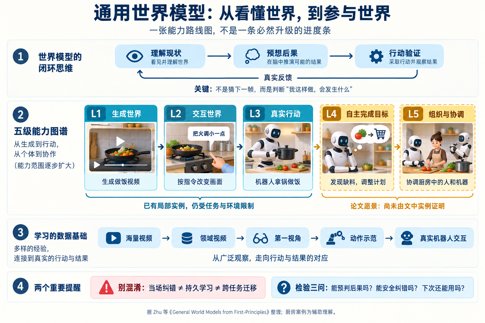

# 通用世界模型｜第一性原理、五级能力地图与证据边界

> 学习归档：保留来源陈述、讨论与原有核验边界；不是对所有事件和数据的重新确认。涉及公司、价格、政策和产品状态，请按原记录日期阅读并回查来源。

## 一句话记住

世界模型最值得关注的，不是能否画出逼真的未来，而是能否预判“我这样做会有什么后果”，用真实反馈纠错，并把有效经验带到下一个任务。

## 材料与阅读定位

- 原文：General World Models from First-Principles，Jun Zhu、Hengkai Tan、Jintao Zhang、Min Zhao、Fan Bao、Bo Zhang；署名机构 GensPI Technology、Tsinghua University。
- [论文 PDF](https://www.motubrain.com/assets/gwm-principles-and-roadmap.pdf)
- [作者官方解读](https://www.motubrain.com/en/research/general-world-models-first-principles-and-a-development-roadmap/)
- 这是定义与发展路线文章，不是“通用世界模型已经实现”的实验结论。下述能力分级属于作者框架，不是行业统一标准。
- 本笔记分开保存原文框架、辅助案例、讨论判断。用户要求归纳及绘图，未对所有判断逐一表态。

## 能力地图

厨房场景是我们帮助理解的示意，不是论文实验。蓝色表示文中已有局部实例，橙色表示尚未由文中实例证明的高阶愿景。箭头表示作者提出的能力扩展方向，不是必然顺序或完成度百分比。

## 核心机制：理解—预想—行动—反馈

作者把通用世界模型理解为连接三种能力的共同基础：推断当前状态、预想不同动作带来的未来、行动并利用反馈更新判断。

理解不仅是认出物体，还包括任务相关状态和不确定性；预测不仅是猜下一帧，更包括候选动作的不同后果；行动也不仅是一个输出接口，它提供校验内部预测的真实证据。

### 辅助例子：端水与开抽屉

端水时，需要判断温度、重量、是否会滑；真正抓起后发现比预想的重，再调整力度。

开抽屉的视频可以接出流畅画面，但真实抽屉可能被卡住。机器人需要判断：是拉力不足，还是内部有障碍？继续加力会不会损坏把手？该换角度还是先检查？

因此，“接下来通常发生什么”与“如果我这样干会发生什么”不是同一问题。视觉逼真不能独立证明可用于物理干预的预测能力。

## 五级路线：从生成到组织

1. **L1 生成世界**：生成连贯的世界轨迹。辅助例子：做饭视频。
2. **L2 交互世界**：持续接收外部输入并改变生成过程。辅助例子：按指令改变画面中的做饭动作。
3. **L3 真实行动**：连接环境理解、未来预测与可执行动作。辅助例子：机器人实际拿锅。
4. **L4 自主完成目标**：围绕长期目标探索、形成中间目标、规划和持续改进。辅助例子：发现缺料并调整计划。自主不等于摆脱人类目标和约束。
5. **L5 组织与协调**：协调多机器人、数字代理、人、工具与资源。辅助例子：协调厨房运营。

作者将 Vidu、Vidu S1、Motus/Motubrain 分别作为前三层的实例，同时承认它们仍有任务和环境边界，不能证明后两层能力。这里记录的是作者对自身系统的定位，不是独立验证结果；本次没有复现其性能指标。

## 学习基础：先见世面，再上手校准

原文提出组合海量视频、领域视频、第一视角视频、带动作记录的人类示范、真实机器人交互。重点是补足从观察到干预证据的距离，不是所有项目都必须机械依次走完五步。

我们的理解：看别人拧瓶盖能学步骤，但自己的夹爪怎么抓、使多大力、打滑如何感知，需要身体与真实接触校准。失败与恢复记录也有价值，不能只留下成功片段。

架构上，作者讨论语言、视觉、动作的专门参数与共享信息交互；计算上，响应必须赶得上现实变化。统一架构是候选实现，不是由“第一性原理”推出的唯一答案。

## 讨论中的三个保留

### 1. 功能需求不等于唯一架构

需要理解、预测、反馈，不代表必须用一个统一大模型。模块化系统也可能有效。应在相近数据、算力和任务下比较实际收益。

### 2. 五级不是同一种能力的线性增长

画面生成、物理控制、长期规划、组织协调存在不同瓶颈。L3不意味着已经完成通向L5的60%；组织能力更强，也不必然说明物理理解更深。

### 3. 闭环不等于持续变聪明

当场重新抓稳杯子，是反馈纠错；下次仍记得如何避免打滑，是持久学习；换杯子、材质或任务仍有效，是迁移。三者需要分开检验。

## 与既往 ICL、RSI 学习的连接

- 看一次示范后成功，可能是在调用训练时已有策略，不足以证明现场学习新技能。
- 改变瓶盖松紧、材质、位置，检查行为是否真的随新证据调整。
- 更长运行、更多重试不自动等于能力增长；应计入算力、耗时、人工介入和事故成本。
- 检验是否存在可持久保存的改进，以及这种改进能否离开原任务和评估器。
- 本次只建立概念连接，未据此更新个人第一性原理主模型。

## 可复用的判断清单

- 它能预测不同动作的后果，还是只生成常见后续画面？
- 预测是否真正改善了决策？去掉预测模块后效果如何？
- 遇到意外时能否安全纠正，必要时停止或求助？
- 新经验是否能跨回合保留？
- 换对象、环境或身体后还能否使用？
- 成功是否依赖大量重试、人工兜底或更高算力？
- 哪些是实测结果，哪些是演示、厂商主张或路线愿景？

## 后续值得追踪

统一模型与模块化方案的对照；接触与力的预测；长时记忆和在线学习；安全恢复；同等预算下的远距离迁移。

## 相关知识

- 世界模型：企业把现场经验变成机器能力的速度
- 麦肯锡季刊：世界模型与企业的“物理经验”复利
- 🧭 deep_learning｜对话式认知共建
